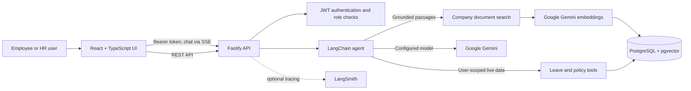

# Nori — an AI-powered HR assistant

**Nori answers HR questions using company documents and live, access-controlled HR data.** It combines retrieval-augmented generation (RAG), model tool-calling, and observable LLM workflows in a full-stack HR portal.

### What Nori can do

- **Find answers in company documents:** Upload supported files, index their text with Gemini embeddings, retrieve relevant passages using PostgreSQL + pgvector, and show document sources in chat.
- **Answer with live HR data:** Use backend tools to look up the signed-in employee's leave balance, requests, and active leave policies—and combine relevant facts rather than relying on model guesswork.
- **Respect user access:** The API supplies verified identity and role context and enforces permissions; the model does not get to choose whose HR records it can query.
- **Show its work:** Stream tool/source activity into the chat UI and optionally trace model/tool runs with LangSmith.
- **Support HR workflows:** Employees can submit or update their own leave requests; authorized HR users can review requests through role-guarded portal/API routes.

The assistant is instructed to ground answers in retrieved evidence and acknowledge when it cannot verify a claim. This is an implemented behavior goal, not a guarantee that every model response is correct.

## Demo

The video and screenshots belong here so visitors can see the portal and Nori's evidence/tool activity before diving into the implementation.

**Video walkthrough:** Add the video link here after uploading it with GitHub's README editor or issue composer; GitHub will provide an asset URL.

**Screenshots:** Add screenshots to the repository (for example, `docs/images/`) and embed them below:

<!--
Replace these notes with your real demo media:

[](PASTE_GITHUB_VIDEO_ASSET_URL_HERE)


-->

## Try the workflow

After signing in and loading policies, leave data, and a company document:

1. Ask **“How much earned leave do I have, and what is the consecutive-day limit?”** Nori can combine the signed-in employee's live balance with the active leave policy.
2. Ask **“What does our benefits document say about medical coverage?”** Nori searches document passages and should say when the retrieved material does not establish an answer.
3. Watch **Sources & activity** in the chat for document, policy, balance, or leave-request tools and their completion status.

Five live-model integration scenarios exercise evidence/tool selection, abstention when evidence is missing, and avoiding a leave action when required details are missing. These use a separately configured test database and Google AI credentials; they are skipped by default.

## Architecture



Uploaded company files are parsed into text chunks, embedded, and stored with their metadata in PostgreSQL. At chat time, Nori can retrieve relevant chunks by vector similarity and call tools that query the authenticated user's leave data and active policies. The API—not the browser or the model—supplies the verified user identity and enforces access rules. LangSmith tracing can be enabled through its environment configuration.

## What is implemented

- **Grounded HR chat:** LangChain.js agent orchestration, Google Gemini chat model, and explicit evidence/abstention instructions.
- **Company-document RAG:** Upload and remove supported documents; extract, chunk, and embed text; retrieve relevant passages using pgvector.
- **HR tools:** Read leave balances, policies, and leave requests; submit or update a leave request when the user explicitly asks and provides required details.
- **HR portal:** React interface for sign-in, leave policies and requests, HR review actions, people directory, document management, and Markdown-rendered chat.
- **Access control:** Short-lived bearer tokens, bcrypt password hashing, role-guarded API routes, and user-scoped personal-data tools.
- **Workflow visibility:** Chat source updates are sent as server-sent events so the UI can show tool activity. Optional LangSmith tracing is configurable.
- **Behavior checks:** Five live-agent integration scenarios cover evidence/tool selection, unsupported-answer abstention, and avoiding a leave action when required details are missing. These are not mocked unit tests and are not run by default.

## Tech stack

| Area | Technologies |
|---|---|
| Frontend | React 19, TypeScript, Vite, React Markdown, remark-gfm |
| API | Node.js, TypeScript, Fastify |
| AI orchestration | LangChain.js, Google Gemini chat model, Gemini embeddings |
| Retrieval and data | PostgreSQL, pgvector, SQL migrations |
| Identity and security | JWT, bcryptjs, Fastify role guards |
| Tracing | LangSmith (optional environment-based tracing) |

## Run locally

Prerequisites: Node.js/npm, PostgreSQL with the `vector` (pgvector) extension available, and a Google AI API key for chat and document embeddings.

### 1. Configure the backend

In PowerShell, from the repository root:

```powershell
Copy-Item server\.env.example server\.env
Set-Location server
npm ci
```

Edit `server/.env` and set at least:

- `DATABASE_URL` — connection string for a PostgreSQL database where the user can enable/use pgvector.
- `GOOGLE_API_KEY` — used for both Nori's model requests and document embeddings.
- `JWT_SECRET` — set a unique random value of at least 32 characters. Local development can start without it, but tokens then expire when the server restarts.

For hosted PostgreSQL requiring a provider CA, set `CA_CERT_PATH` to a local PEM file. TLS verification remains enabled. Do not commit the certificate or credentials.

### 2. Migrate and provision an account

From `server/`:

```powershell
npm run db:migrate
npm run db:check
npm run db:create-user -- --user-id ADM-0001 --name "Jordan Lee" --email jordan@example.com --role super_admin --department Administration
npm run dev
```

The account-creation command prompts for a password without echoing it. Public registration, when used, creates employee accounts only. Migrations create the schema; no demo users, company policies, or sample documents are bundled. Add the company policies and demo data appropriate to your test database before trying evidence-based answers.

### 3. Start the frontend

In a second terminal, from the repository root:

```powershell
Set-Location client
npm ci
npm run dev
```

Open the local Vite URL shown in the terminal (normally `http://localhost:5173`). Vite forwards `/api` requests to the backend at `http://127.0.0.1:3001`.

### 4. Build and test

```powershell
# From client/
npm run build
npm run lint

# From server/
npm run build
npm test
```

The server's five live-agent tests are skipped unless `AI_AGENT_INTEGRATION=1` is set. To run them, configure `AI_AGENT_TEST_DATABASE_URL` to a migrated, disposable database whose name includes `test`, `sandbox`, or `integration`, set `AI_AGENT_TEST_USER_ID` to an active employee in that database, and ensure `GOOGLE_API_KEY` is available. Never use production data for this suite. See [server/README.md](server/README.md#live-agent-integration-tests) for the complete prerequisites.

## Environment variables

Set these in `server/.env`; secrets belong on the server only.

| Variable | Required | Purpose |
|---|---:|---|
| `DATABASE_URL` | Yes | PostgreSQL connection string. |
| `GOOGLE_API_KEY` | Yes for chat and document indexing | Google AI credential for Gemini chat and embeddings. |
| `GOOGLE_MODEL` | Yes | Gemini model name used for chat (the sample uses `gemini-3.1-flash-lite`). |
| `JWT_SECRET` | Production | At least 32 characters; a temporary random secret is generated in local development if omitted. |
| `HOST`, `PORT` | No | API bind address and port; defaults are `127.0.0.1` and `3001`. |
| `CLIENT_ORIGIN` | No | Comma-separated allowed browser origins. |
| `CA_CERT_PATH` | No | Path to a provider CA PEM for verified TLS to hosted PostgreSQL. |
| `COMPANY_DOCUMENTS_DIR` | No | Uploaded-file storage directory; defaults to `server/storage/company-documents`. |
| `LANGSMITH_TRACING`, `LANGSMITH_API_KEY`, `LANGSMITH_PROJECT` | No | Optional LangSmith trace capture and project selection. |

`server/.env.example` is the source of defaults. The backend ignores local `.env`, uploaded storage, build output, and `ca.pem`; never commit API keys, database credentials, or private certificates.

## Current limitations

- This is a portfolio project, not a production-validated HR system. Review provider data handling and retention before sending real employee or medical information to an LLM.
- Leave requests are currently counted in calendar days. Business-day/holiday rules, annual allowance enforcement, and manager approval chains are not implemented.
- HR/admin provisioning is operator-managed; public registration is not backed by email verification or an invitation flow.
- Chat history is held in the browser and sent with requests; it is not persisted in PostgreSQL. The API accepts a bounded recent history.
- Chat answers depend on the configured model, populated company documents, and current database records. The agent is instructed to ground answers and abstain when evidence is missing, but this is not a guarantee of correctness.
- The behavior suite uses a real model and database, takes external credentials and seeded records, and can vary with those records; it is skipped unless explicitly enabled.

## Project documentation

- [Backend setup, API behavior, and integration-test details](server/README.md)
- [Frontend implementation and development commands](client/README.md)
- [Database migration notes](server/src/db/README.md)
